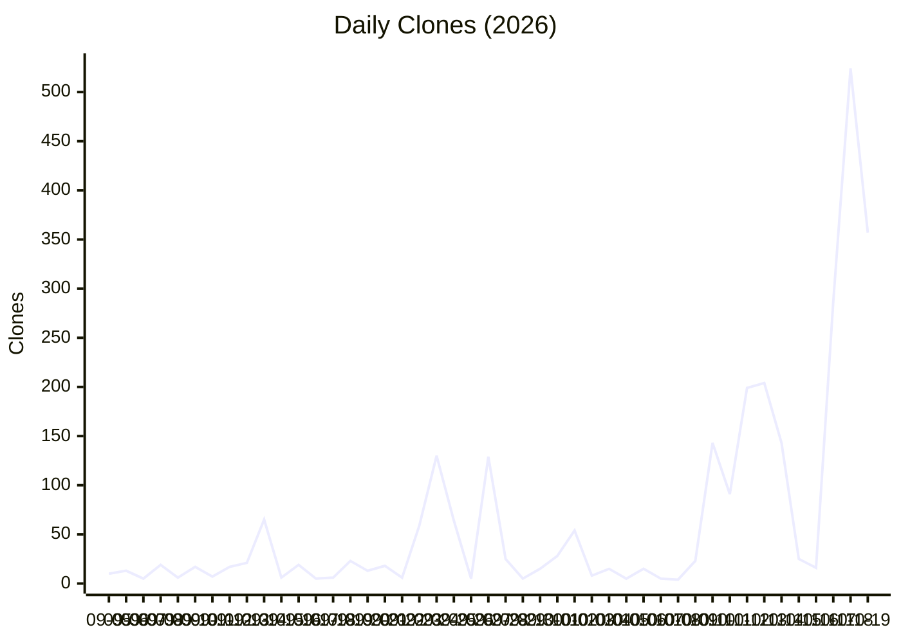
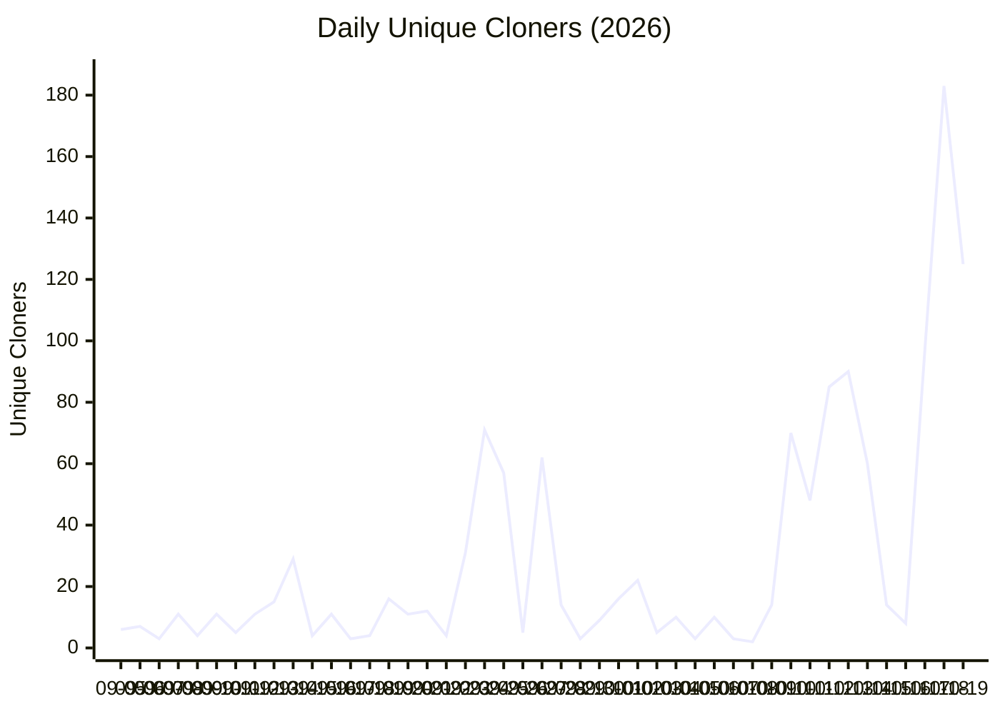
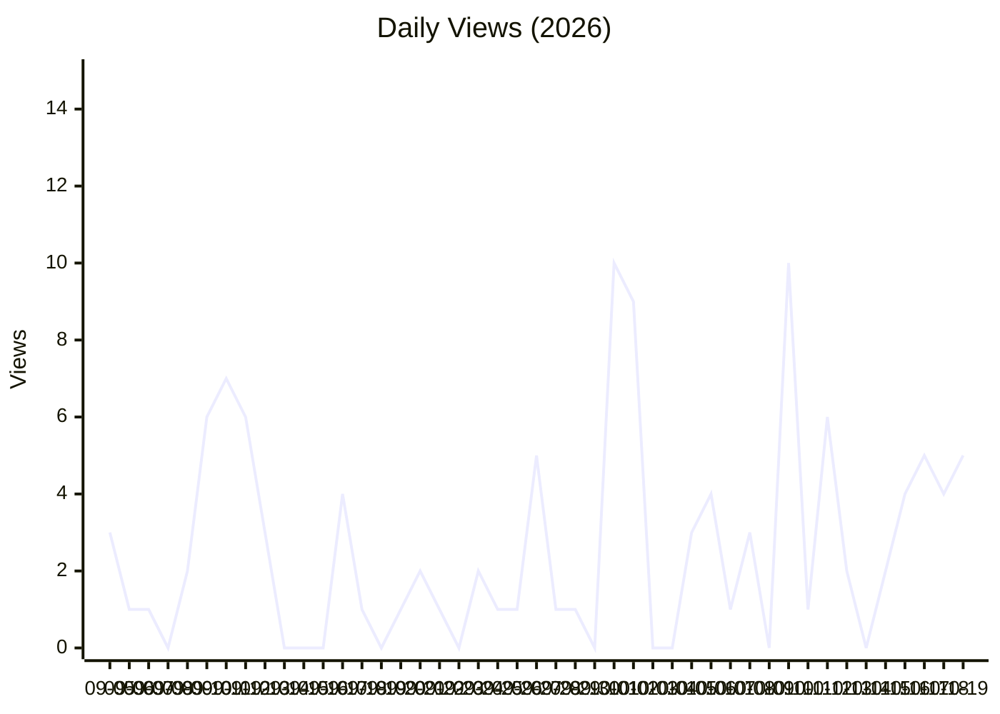
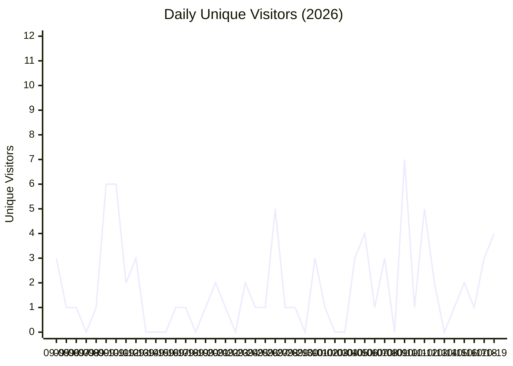

# Repository Traffic Report

**Last updated:** 2026-10-21T08:06:01 UTC

## Latest 14-day totals

- **Clones:** 2036 total · 569 unique
- **Views:** 47 total · 28 unique

## Clones over time

## Unique Cloners over time

## Views over time

## Unique Visitors over time

## Recent daily numbers

| Date | Clones | Unique Cloners | Views | Unique Visitors |
|------|--------|----------------|-------|-----------------|
| 10-19 | 357 | 125 | 5 | 4 |
| 10-18 | 524 | 183 | 4 | 3 |
| 10-17 | 287 | 97 | 5 | 1 |
| 10-16 | 16 | 8 | 4 | 2 |
| 10-15 | 25 | 14 | 2 | 1 |
| 10-14 | 143 | 60 | 0 | 0 |
| 10-13 | 204 | 90 | 2 | 2 |
| 10-12 | 199 | 85 | 6 | 5 |
| 10-11 | 91 | 48 | 1 | 1 |
| 10-10 | 143 | 70 | 10 | 7 |
| 10-09 | 23 | 14 | 0 | 0 |
| 10-08 | 4 | 2 | 3 | 3 |
| 10-07 | 5 | 3 | 1 | 1 |
| 10-06 | 15 | 10 | 4 | 4 |
| 10-05 | 5 | 3 | 3 | 3 |
| 10-04 | 15 | 10 | 0 | 0 |
| 10-03 | 8 | 5 | 0 | 0 |
| 10-02 | 54 | 22 | 9 | 1 |
| 10-01 | 28 | 16 | 10 | 3 |
| 09-30 | 15 | 9 | 0 | 0 |
| 09-29 | 5 | 3 | 1 | 1 |
| 09-28 | 25 | 14 | 1 | 1 |
| 09-27 | 129 | 62 | 5 | 5 |
| 09-26 | 5 | 5 | 1 | 1 |
| 09-25 | 64 | 57 | 1 | 1 |
| 09-24 | 130 | 71 | 2 | 2 |
| 09-23 | 59 | 31 | 0 | 0 |
| 09-22 | 6 | 4 | 1 | 1 |
| 09-21 | 18 | 12 | 2 | 2 |
| 09-20 | 13 | 11 | 1 | 1 |

---
*Generated automatically by the traffic logging workflow.*